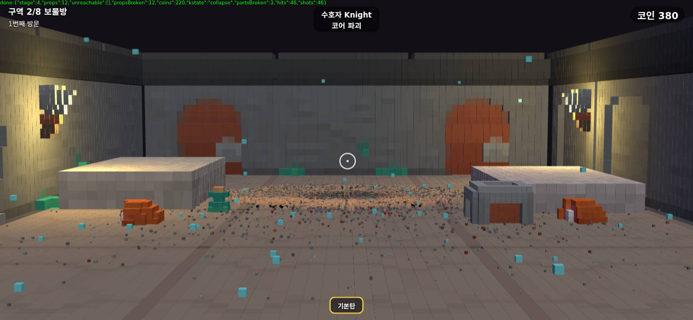

# 코어브레이커2 : 와장창 던전

던전 보물 테마의 복셀 파괴 슈터입니다. 1인칭 고정 시점에서 투사체를 쏴서 소품을 부수고, 수호 기사의 장비를 모두 부수면 드러나는 코어를 맞혀 몸 전체를 무너뜨립니다.

원작: [sigco3111/everyday-game 의 smash](https://github.com/sigco3111/everyday-game/tree/main/smash). 에셋은 모두 교체하고 시스템을 키운 새 게임입니다.

## 현재 상태

구역 테마 8개가 순서대로 열립니다(2 보물방 → 3 연회장 → 4 무너진 회랑 → 5 기둥의 방 → 6 침실과 서재 → 7 창고 → 8 무기고 → 1 술창고). 구역마다 벽 구성, 조명과 배경색, 소품, 지형(단상, 벽감, 기둥)이 다르지만 방 크기와 수호자 배치 구조는 같습니다. 구역 고유 기믹과 보스는 아직 없습니다.

- 가로 화면 고정, 플레이어 완전 고정, 시점은 원근을 줄인 B안
- 화면을 눌러(터치) 발사. 부술 물체는 카메라 기준 약 4.8~9.2m 구간에만 배치
- 수호자 3명이 좌우로 움직이며, 푸른 빛이 나는 동안은 막습니다. 종류는 기사, 야만전사, 마법사, 도적, 해골 전사, 해골 마법사, 해골 도적, 해골 병사 8종(구성은 방문마다 무작위, 최소 2종)
- 장비(머리 장식, 방패, 무기 등)를 모두 부수면 코어가 드러나고, 코어를 맞히면 몸 전체가 복셀로 무너짐. 장비를 모두 부수기 전에는 몸통이 깎이지 않음
- 무기 3종(기본탄, 범위탄, 관통탄)과 Lv1~5 강화 상점, 수집 도감
- 방문 횟수와 구역 순서에 따라 수호자가 빨라지고 방어 시간이 길어짐
- 기록 대시보드(플레이, 클리어, 최단 시간, 명중률, 최근 방문 표), 코인과 강화는 기기에 저장(localStorage)
- 효과음은 WebAudio로 합성(외부 음원 없음), 좌하단에서 끄기

위 화면은 소프트웨어 렌더링 환경에서 스크립트로 진행해 캡처한 것입니다.

## 확인 상태

- 확인함(헤드리스 소프트웨어 렌더, 스크립트 조작): 구역 1~8 모두에서 장비 파괴, 코어 노출, 붕괴 완료. 저장과 구역 해금, 상점 구매 후 코인과 강화 보존. 667x375, 844x390 화면에서 시작 화면이 스크롤 없이 들어감
- 미확인: 사람 손 조작, 터치 조준감, 휴대폰 성능(fps), 효과음 음량과 음색
- 미구현: 걷기 애니메이션, 이동 중 부위별 장비 파괴, 구역별 고유 기믹과 보스
- 알려진 한계: 화면 가장자리 단상 위의 일부 소품은 조준하기 어려워 남을 수 있음(진행에는 영향 없음)

## 로드맵

진행 중: 구역 차별화, 적 종류 확대 / 이후: 보스, 실기기 점검과 밸런스

## 에셋과 라이선스

| 에셋 | 출처 | 라이선스 |
| --- | --- | --- |
| KayKit Dungeon Remastered (소품, 벽, 바닥) | Kay Lousberg, https://kaylousberg.itch.io/kaykit-dungeon-remastered | CC0 |
| KayKit Character Pack Adventurers (Knight, Barbarian, Mage, Rogue) | Kay Lousberg, https://kaylousberg.itch.io/kaykit-adventurers | CC0 |
| KayKit Character Pack Skeletons 1.0 (Warrior, Mage, Rogue, Minion와 무기) | Kay Lousberg, https://github.com/KayKit-Game-Assets/KayKit-Character-Pack-Skeletons-1.0 (LICENSE.txt에 CC0 명시) | CC0 |
| three.js | https://threejs.org | MIT |

3D 모델은 복셀로 변환해 `props.json`, `knight_demo.json`, `guardians/*.json` 으로 저장했습니다.

## 실행

정적 파일입니다. 로컬에서는 `python3 -m http.server` 후 `index.html` 을 엽니다.
