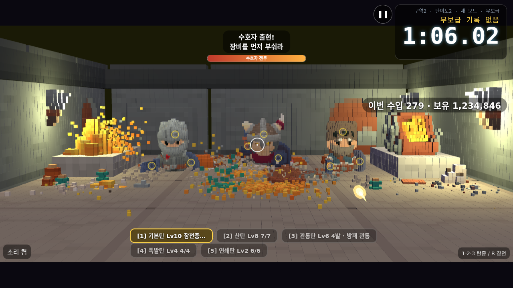
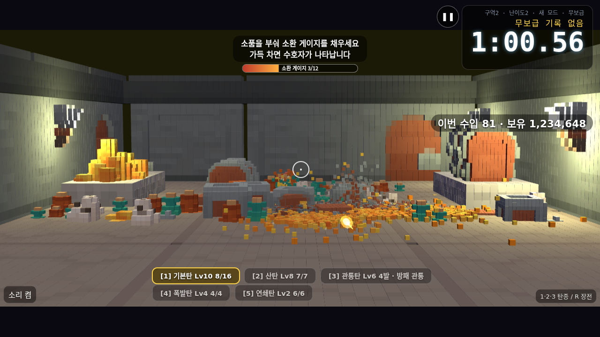
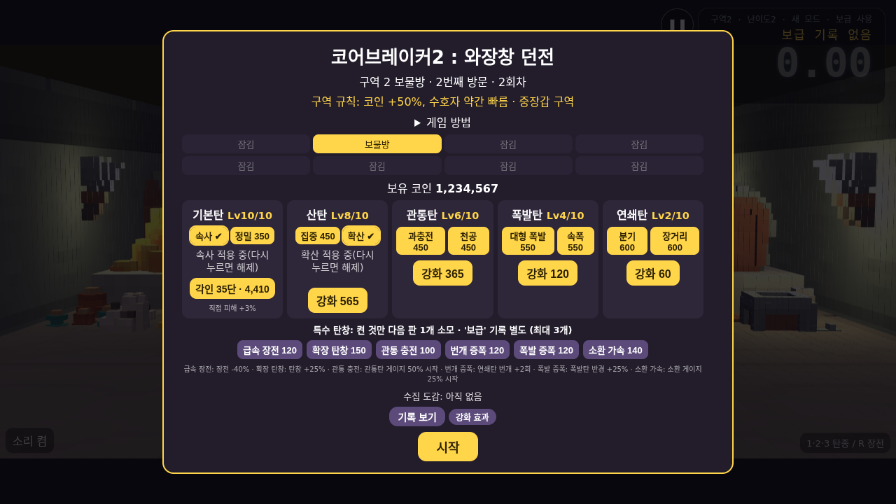
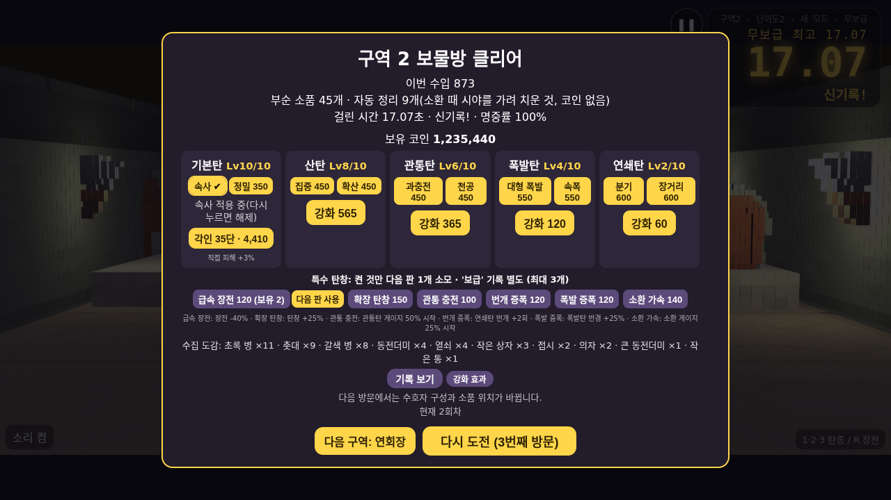

# 코어브레이커2 : 와장창 던전



던전의 방을 통째로 부수는 복셀 파괴 슈터입니다. 1인칭 고정 시점에서 투사체를 쏴 소품을 부수며 소환 게이지를 채우고, 나타난 수호자의 장비를 모두 부숴 드러난 코어를 맞히면 몸 전체가 복셀로 무너집니다.

- 플레이: https://sigco3111.github.io/corebreaker2-dungeon/
- 원작: [sigco3111/everyday-game 의 smash](https://github.com/sigco3111/everyday-game/tree/main/smash). 에셋은 모두 교체하고 시스템을 새로 키운 별개의 게임입니다.

## 게임 방법

1. 방에 놓인 소품(술통, 상자, 보물 상자 등 수십 개)을 부수면 소환 게이지가 차오릅니다.
2. 게이지가 가득 차면 수호자 3체가 소환됩니다.
3. 수호자는 푸른 빛이 나는 동안 공격을 막습니다. 막히지 않을 때 장비(모자, 방패, 무기 등)를 먼저 부수세요.
4. 장비를 모두 부수면 코어가 드러나고, 코어를 맞히면 수호자가 붕괴합니다. 3체를 모두 쓰러뜨리면 구역 클리어입니다.
5. 클리어 보상 코인으로 상점에서 무기를 강화하고 다음 구역으로 나아갑니다.

조작: 화면을 눌러(클릭/터치) 발사, 키보드 1~5 탄종 선택, R 재장전. 가로 화면 기준.

## 주요 특징

- 구역 8종 순환: 술창고, 보물방, 연회장, 무너진 회랑, 기둥의 방, 침실과 서재, 창고, 무기고. 구역마다 소품 구성, 조명, 지형, 규칙 배율(수호자 속도, 방어, 코인 등)이 다릅니다. 같은 구역을 다시 방문할수록 수호자가 빨라지고 방어가 길어집니다.
- 수호자 8종: 기사, 야만전사, 마법사, 도적, 해골 전사, 해골 마법사, 해골 도적, 해골 병사. 방문마다 구성이 바뀌고 구역별 테마 풀이 있습니다.
- 무기 5종: 기본탄(12발 연사), 산탄(파편 9발, 천/나무 장비에 강함), 관통탄(방패 관통, 명중 게이지로 장전), 폭발탄(범위 파괴), 연쇄탄(체인 라이트닝). 각 Lv1~10 강화.
- 개조: 무기마다 2종 중 하나를 선택(예: 기본탄 속사/정밀, 연쇄탄 분기/장거리). 언제든 바꿀 수 있습니다.
- 각인: Lv10 이후의 영구 성장 소모처. 단마다 직접 피해 +3%, 10단마다 발사 간격과 장전 시간 -5%(최대 -25%), 99단 상한. 가격은 15단까지 ×1.15, 이후 ×1.03의 2구간 곡선입니다.
- 특수 탄창(보급): 급속 장전, 확장 탄창, 관통 충전, 번개 증폭, 폭발 증폭, 소환 가속 6종. 최대 3개까지 쌓아 두고, 켠 것만 다음 판에 1개씩 소모합니다. 코인을 늘려 주는 품목은 없습니다.
- 수집 도감: 부순 소품이 종류별로 기록됩니다.
- 기록 대시보드: 플레이 수, 클리어 수, 구역별 최단 시간, 명중률, 최근 방문 기록. 진행 상황은 기기(localStorage)에 저장됩니다.
- 그 외: 급소 명중 1.5배, 폭발통 연쇄, 구역 8 ★정예 수호자(보상 3배), 우측 상단 타임어택 HUD, WebAudio 합성 효과음.



소품을 부수며 소환 게이지를 채우는 단계입니다.


소환된 수호자 3체와의 전투. 장비 표식(노란 고리)을 노려 코어를 노출시킵니다.



클리어 전후 상점에서 강화, 개조, 각인, 특수 탄창을 구매합니다.



클리어 결과 화면. 수입, 부순 소품, 걸린 시간, 명중률과 이번 판 성장을 정리해 보여 줍니다.

## 설치와 실행

정적 파일이라 설치가 없습니다. 위 플레이 링크를 열면 바로 실행됩니다.

로컬에서 실행하려면 저장소를 받은 뒤 정적 서버를 띄웁니다:

```bash
python3 -m http.server
# 브라우저에서 http://localhost:8000/ 접속
```

## 기술 노트

- 단일 페이지(`index.html` + `game.js`), 빌드 없이 배포. GitHub Pages로 서비스합니다.
- 렌더링은 three.js(저장소에 번들된 `three.module.js`). WebGL 소프트웨어 렌더 환경에서도 동작을 확인했습니다.
- 3D 모델(GLB)을 복셀로 변환해 `props.json`, `knight_demo.json`, `guardians/*.json`에 저장하고, 파괴는 복셀 단위로 계산합니다.
- 세이브는 `localStorage`. 효과음은 WebAudio 합성(외부 음원 없음).
- `docs/` 아래에는 개발 중 사용한 자동 검증 페이지들이 있습니다(조준, 가격, 저장/복원, 클리어 흐름, 난이도 곡선 등을 헤드리스에서 실측).

## 확인 상태

- 확인함(헤드리스 소프트웨어 렌더, 스크립트 조작 실측): 구역 1~8 클리어, 조준 불가능 부위 0건, 구매→저장→재접속 복원, 클리어→다음 구역→재도전 흐름, 각인 가격 곡선과 99단 상한, 고난이도(방문 누적) 클리어 가능, PC(1280×720)와 모바일(844×390) 화면 배치.
- 사용자가 실제 휴대폰에서 실행 확인.
- 미확인: 실기기 조준감과 프레임률, 효과음 음량과 음색, 탄종 밸런스의 체감. 이 항목들은 플레이하며 조정이 필요할 수 있습니다.

## 에셋과 라이선스

| 에셋 | 출처 | 라이선스 |
| --- | --- | --- |
| KayKit Dungeon Remastered (소품, 벽, 바닥) | Kay Lousberg, https://kaylousberg.itch.io/kaykit-dungeon-remastered | CC0 |
| KayKit Character Pack Adventurers (Knight, Barbarian, Mage, Rogue) | Kay Lousberg, https://kaylousberg.itch.io/kaykit-adventurers | CC0 |
| KayKit Character Pack Skeletons 1.0 (Warrior, Mage, Rogue, Minion와 무기) | Kay Lousberg, https://github.com/KayKit-Game-Assets/KayKit-Character-Pack-Skeletons-1.0 (LICENSE.txt에 CC0 명시) | CC0 |
| three.js | https://threejs.org | MIT |

3D 모델은 복셀로 변환해 `props.json`, `knight_demo.json`, `guardians/*.json`으로 저장했습니다. 게임 코드는 MIT 라이선스입니다(LICENSE 파일 참조).

## 크레딧

- 원작 게임: [smash](https://github.com/sigco3111/everyday-game/tree/main/smash) (sigco3111/everyday-game)
- 에셋: Kay Lousberg (KayKit)
- 라이브러리: three.js
